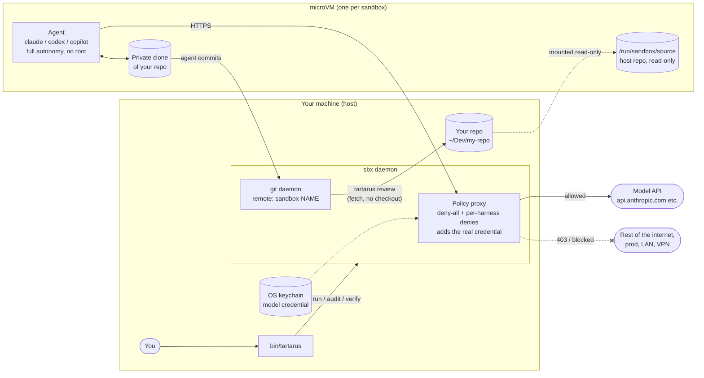
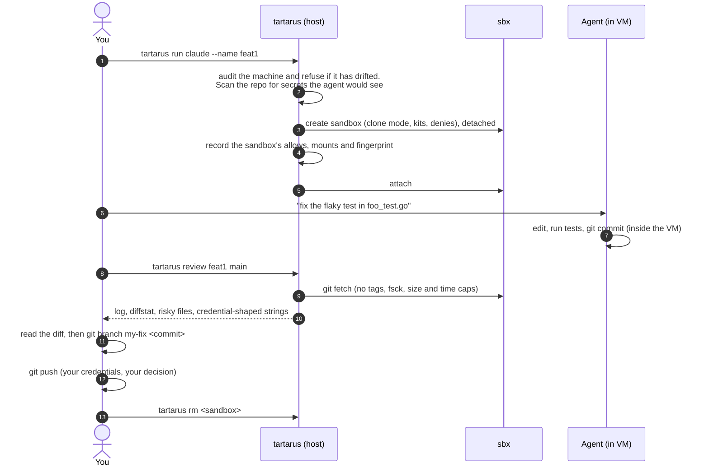
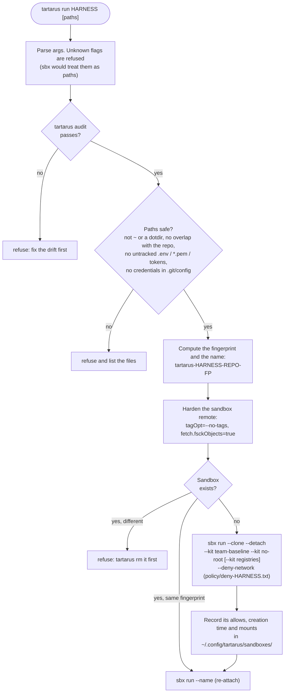
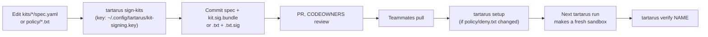

# Tartarus

Run AI coding agents (GitHub Copilot CLI, Claude Code, Codex) at full autonomy inside hardened [Docker Sandboxes](https://docs.docker.com/ai/sandboxes/) (`sbx`). The network denies everything by default, no host secrets get in, and the agent has no route to production. **The agent proposes changes and a human reviews and pushes them.**

> In Greek myth, Tartarus is the prison that held the Titans: powerful, and kept where they can't reach the world above.

This README covers what Tartarus does, how to use it, and how it works. For the reasoning, the threat model and the test evidence behind each lockdown layer, see [PROPOSAL.md](PROPOSAL.md).

**Contents:** [Why](#why) · [How it works](#how-it-works) · [Concepts](#concepts) · [Install](#install) · [Your first session](#your-first-session) · [Commands](#commands) · [What `run` does](#what-run-does) · [Reviewing agent work](#reviewing-agent-work) · [Configure](#configure) · [Changing kits and policy](#changing-kits-and-policy) · [Lockdown layers](#lockdown-layers) · [What it doesn't protect](#what-it-does-and-doesnt-protect) · [Troubleshooting](#troubleshooting) · [Repo layout](#repo-layout) · [Test](#test)

---

## Why

Every harness has an autopilot mode (`copilot --yolo`, `claude --dangerously-skip-permissions`, `codex --dangerously-bypass-approvals-and-sandbox`). On your laptop, that agent runs as you, so it can use everything you can: Vault tokens, `op run` env vars, kube contexts, cloud credentials, your SSH agent and the corporate network.

Tartarus keeps autopilot and removes that reach:

| On the host (no Tartarus) | In a Tartarus sandbox |
|---|---|
| Sees your whole filesystem | Sees only the repo you pass in, through a private clone. The host repo is read-only |
| Inherits `VAULT_TOKEN`, `AWS_*`, `SSH_AUTH_SOCK`… | Starts with a clean VM environment. No host env vars and no SSH agent |
| Reaches any host your machine can | Reaches only its own model API. Everything else is denied |
| Holds the real model token | Sees a placeholder; the host-side proxy adds the real token to each request |
| Can `git push` anywhere | Commits inside the VM; you fetch, review and push from the host |
| Has `sudo` | Has no root (the `no-root` kit) |

## How it works

`sbx` runs each agent in its own microVM with its own kernel, filesystem and Docker daemon. All traffic goes through a proxy on the host. Tartarus is one bash script (`bin/tartarus`) that configures `sbx` strictly, launches sandboxes in a known state, and checks that the machine and the sandboxes stay that way.



The loop you'll repeat:



## Concepts

| Term | Meaning |
|---|---|
| **sbx** | Docker Sandboxes CLI. It runs agents in microVMs behind a host-side network proxy. Tartarus wraps it |
| **Harness** | The agent CLI: `claude`, `codex` or `copilot` |
| **Kit** | A `spec.yaml` that adds network rules, files or startup commands to a sandbox. Tartarus ships three *mixins* (kits that layer onto any harness) under `kits/` |
| **Policy** | Network rules. `setup` sets the global policy to `deny-all` and adds `policy/deny.txt`. `run` adds `policy/deny-<harness>.txt` to each sandbox, which closes hosts the harness's own kit would otherwise allow |
| **Signed** | Every kit and policy file is signed with the team key. `sbx` and `tartarus` refuse an edited file until someone runs `tartarus sign-kits` |
| **Clone mode** | `sbx run --clone`: the agent works on a private clone inside the VM. Its commits come back through a `sandbox-<name>` git remote on the host |
| **Approval prompt** | When the agent hits a blocked host, `sbx` queues a prompt. Allowing one saves a **permanent** allow, so always dismiss (`tartarus dismiss`). `audit` fails if any allow was saved that way |
| **Fingerprint** | A checksum of the launcher, kits, policy, harness, resources and mounts. It goes into the default sandbox name so that a config change gives you a fresh sandbox. A sandbox keeps the config it was created with |
| **Audit / verify** | `audit` checks the host's `sbx` config. `verify` runs `audit` plus a battery of checks inside each sandbox (secrets, root, mounts, egress) |

## Install

**Requirements:** `sbx` (signed in with `sbx login`; on macOS it needs Tahoe 26 or later), bash 4.4 or later (macOS ships 3.2: `brew install bash`), `git`, `python3` and `openssl`. `yq` (either flavour) is optional; `tartarus config` uses it to list kit allows.

```sh
# 1. Install sbx and sign in
brew install docker/tap/sbx            # macOS
sudo apt-get install docker-sbx        # Ubuntu, after adding Docker's apt repo
sbx login

# 2. Put tartarus on your PATH (a symlink is fine; it finds its kits through it)
git clone <this repo> ~/Dev/tartarus
ln -s ~/Dev/tartarus/bin/tartarus ~/.local/bin/tartarus

# 3. Harden sbx on this machine. Safe to re-run.
tartarus setup     # WARNING: restarts the sbx daemon, which stops running sandboxes

# 4. Check it
tartarus audit
```

A passing audit ends with:

```text
audit: OK (settings pinned, global policy deny-all, only model credentials stored)
```

What `setup` changes on your machine:

```sh
sbx settings set ssh.agentForwardingEnabled false   # and ~15 more: SETTINGS in bin/tartarus
sbx settings set kit.allowedSources '["docker.io/sbx/"]'
sbx policy reset --force && sbx policy init deny-all
sbx policy deny network '*.prod.yourco.com'          # each host in policy/deny.txt
sbx policy deny network --method PUT,POST,PATCH,DELETE registry.npmjs.org   # no npm publish (same for PyPI)
sbx settings set kit.trustedSigners '[<Docker>, {"key": "~/.config/tartarus/kit-signing.pub"}, <Copilot kit workflow>]'
sbx settings set kit.requireSignature true
sbx daemon restart
```

## Your first session

```sh
# Store the model credential on the host. It never enters the VM.
tartarus login claude     # or: codex, copilot
#   Claude subscriptions can skip this and run /login inside the sandbox (OAuth, token stays on the host)

cd ~/Dev/my-repo
tartarus run claude --name feat1
```

You're now in Claude Code, running with `--dangerously-skip-permissions` inside the VM. Give it a task and let it commit. To pass flags to the agent, put them after `--`. Arguments that start with `-` are added after the autonomy flags; a bare word replaces them:

```sh
tartarus run claude --name feat1 -- --model opus
```

When it's done, from another terminal on the host:

```sh
tartarus review feat1 main          # the agent's branch name, as it sees it
git branch feat1-work 3f9c2a1…      # the exact commit review printed
git diff main feat1-work            # read ALL of it before running anything
git push origin feat1-work          # your push, your credentials
tartarus rm feat1                   # when the work is merged
```

Close the agent and come back later with the same `tartarus run claude --name feat1`: the sandbox and its clone persist until you `rm` it.

## Commands

| Command | What it does |
|---|---|
| `tartarus setup` | Pins sbx settings, rebuilds the global policy as `deny-all` plus `policy/deny.txt`, trusts the team signing key and restarts the sbx daemon |
| `tartarus audit` | Checks that this machine still matches `setup`: settings, policy, signatures, stored secrets, MCP servers, published ports, and each sandbox's kits, allows and mounts. `run` runs it first and refuses to start if it fails |
| `tartarus config` | Shows every setting, its current value and where to change it |
| `tartarus login <harness>` | Stores the model credential in the host keychain |
| `tartarus run <harness> [--name N] [--detach] [path…] [-- agent args]` | Starts the agent in a clone-mode sandbox. The first path is the repo (default `.`). Extra paths mount read-only; add `:rw` to make one writable |
| `tartarus verify [name…]` | Runs `audit`, then the in-sandbox checks (no name: every sandbox tartarus made) |
| `tartarus review <name> <branch>` | Fetches the agent's branch without checking it out and flags anything risky. **Exits 2** if it finds anything |
| `tartarus ls` | Lists sandboxes and flags those made before the current lockdown (exits 1 if any) |
| `tartarus dismiss [name…]` | Dismisses pending approval prompts. Never allow one |
| `tartarus rm <name…>` | Removes sandboxes, their prompts and the git refs `sbx` leaves in your repo |
| `tartarus sign-kits` | Signs changed kits and policy files with the team key |
| `tartarus safe <harness>` | Fallback without `sbx`: runs the agent on the host in a scrubbed env inside the harness's own sandbox. Much weaker isolation |

### Working across several repos

```sh
tartarus run claude ~/Dev/web-app ~/Dev/shared-lib        # shared-lib is mounted read-only
tartarus run claude ~/Dev/web-app ~/Dev/shared-lib:rw     # writable, but its .git stays read-only
```

Clone mode protects only the first path. Extras are direct mounts at the same path as on the host, so a `:rw` extra is agent output that `review` never sees. Mount only what the task needs, never all of `~/Dev`.

## What `run` does



The records in `~/.config/tartarus/sandboxes/` let `audit` catch later tampering: a kit added with `sbx kit add`, a mount added with `sbx mount`, or allows that grew.

## Reviewing agent work

Fetching isn't approval. Many files run code on your machine as soon as you check out, build or open the branch in an IDE: git hooks, CI config, `.vscode/tasks.json`, `Makefile`, `package.json` scripts, lockfiles, `.envrc`, `CLAUDE.md` (prompt injection aimed at the next agent you run on the host), compiled binaries, symlinks and more. `review` treats the agent's git remote as hostile:

- It fetches **without tags** (a tag named `main` would shadow your branch) and with object checks (`fsck`), capped at 4 GiB and 10 minutes.
- It **never checks out** the branch and pins the exact commit it reviewed.
- It **flags** every changed file in roughly 15 categories of code that runs on its own, plus symlinks, submodule moves, credential-shaped strings in added lines or commit messages, and files over 1 MiB.
- It **strips terminal escapes** from everything it prints, because commit messages and file names are the agent's text.

Example:

```text
$ tartarus review feat1 main
a1b2c3d Fix flaky retry test
 .vscode/settings.json   |  3 +++
 internal/retry/retry.go | 12 ++++++------
 internal/retry/retry_test.go | 20 ++++++++++++++------
 3 files changed, 23 insertions(+), 12 deletions(-)

REVIEW BEFORE CHECKOUT, BUILD OR OPENING IN AN IDE (these run code on the host):
  .vscode/settings.json

See just those changes: git diff 9e8d7c6b5a41 a1b2c3d4e5f6 -- :\(literal\).vscode/settings.json

Every changed file runs once you test, build or start the app on the host: read the whole
diff first, or run them in the sandbox (sbx exec -it feat1 bash).
Reviewed a1b2c3d4e5f6…. Take exactly that commit, not the branch, which moves on the next fetch:
  git branch <name> a1b2c3d4e5f6…
$ echo $?
2
```

> [!IMPORTANT]
> `review` lists only the files that run *on their own*. Once you run tests or the app on the host, **every** changed file runs, including a backdoor in `src/` that a test imports. Read the whole diff, or run the tests inside the sandbox (`sbx exec -it <name> bash`).

## Configure

`tartarus config` shows every setting, its current value and where to change it.

| Setting | Where | Then |
|---|---|---|
| Domains sandboxes may reach (none by default) | `kits/team-baseline/spec.yaml` (`permissions.network.allow`) | `tartarus sign-kits`, commit |
| Allow npm and PyPI for a run (read-only: no publish) | `TARTARUS_REGISTRIES=1` (`kits/registries`) | next `run` |
| Prod hosts to block | `policy/deny.txt` | `tartarus sign-kits`, commit, `tartarus setup` |
| Per-harness blocked hosts | `policy/deny-<harness>.txt` | `tartarus sign-kits`, commit |
| Pinned sbx settings | `SETTINGS` in `bin/tartarus` | `tartarus setup` |
| CPUs / memory | `TARTARUS_CPUS` (4) / `TARTARUS_MEMORY` (8g) | next `run` |
| Keep root for the agent: sudo, Docker, writable `~/.local/bin` (`pip install --user`, `npm -g`) | `TARTARUS_ALLOW_ROOT=1` | next `run` |
| Mount paths holding `.env`, keys and similar untracked files | `TARTARUS_ALLOW_SECRET_FILES=1` | next `run` |
| Copilot kit version (pinned by digest) | `COPILOT_KIT` in `bin/tartarus` | verify the new digest first (see the comment there) |
| Alternate kit, deny file, kit sources, signing key | `TARTARUS_BASELINE_KIT`, `TARTARUS_DENY_FILE`, `TARTARUS_KIT_SOURCES`, `TARTARUS_SIGNING_KEY` | |

Example: the agent needs npm for this task only.

```sh
TARTARUS_REGISTRIES=1 tartarus run claude --name feat1-npm   # a new config means a new sandbox
```

Sandboxes don't see your user-level harness config (`~/.claude`, `~/.codex`). Put shared agent instructions (`CLAUDE.md`, `AGENTS.md`) in the repo, or in `kits/team-baseline/files/home/`.

## Changing kits and policy

Kits run code as root in every sandbox, and the deny lists decide what every sandbox can reach. Both are signed, and `kits/` and `policy/` need a CODEOWNERS review.



- An edited, unsigned or missing kit or policy file is refused by `sbx`, `setup`, `run` and `audit` until it's re-signed.
- The first `sign-kits` in a repo with no `kits/signing.pub` creates the team key under `~/.config/tartarus/`, outside the repo. Share the private key only with people who may approve kit changes.
- `setup` pins `kits/signing.pub`. If it later changes or disappears, `setup` refuses until you check `git log kits/signing.pub` and re-run with `TARTARUS_REPIN=1`.
- Existing sandboxes keep their old config. `tartarus ls` shows which ones predate the change; `rm` them.

To add a harness that `sbx` supports (Gemini, OpenCode…), add a `case` arm in `harness_agent` and `cmd_login` in `bin/tartarus`, plus a signed `policy/deny-<harness>.txt`.

## Lockdown layers

Every layer was tested against `sbx` v0.48.0, each with a control that proves the check can fail. The evidence is in [PROPOSAL.md § Lockdown layers](PROPOSAL.md#lockdown-layers).

| Layer | Stops | Checked by |
|---|---|---|
| `deny-all` global policy | Exfiltration to S3, GCS, pastebin, GitHub… (`balanced` allows about 190 hosts) | `audit`, `verify` |
| Per-harness deny lists | claude.ai connectors (Gmail, Drive), remote control, self-update, GitHub uploads | `audit`, `verify` |
| Registry write denies | `npm publish` / `twine upload` even when registries are on | `audit` |
| SSH agent forwarding off | Signing with your 1Password or ssh-agent keys | `audit`, `verify` |
| Credentials on the host only | Real tokens inside the VM (placeholders only) | `verify` (token scan) |
| `no-root` kit | Guest root, the usual first step of a VM escape; root running agent-planted files | `verify` |
| Clipboard bridge removed | A clipboard channel to the host | `verify` |
| Clone mode, read-only extras | The agent writing your repo, its hooks or `.git/config` | `verify` |
| Secret-file refusal | Untracked `.env`, keys or tokens visible through the read-only mount | `run` |
| Signed kits and policy | A tampered kit or deny list | `sbx`, `audit` |
| Fingerprinted names | Re-attaching to a sandbox built under an older lockdown | `run`, `ls` |
| No approval-created allows | One click permanently widening the policy | `audit` |
| No registered MCP servers | The MCP gateway pulling host servers into the sandbox | `audit`, `verify` |
| Mount, kit and port tracking | `sbx mount`, `sbx kit add`, `sbx ports --publish` after creation | `audit`, `verify` |
| Hardened `review` | Hostile tags, malformed objects, huge packs, terminal escapes | `review` |

A passing `verify` looks like this (abridged):

```text
$ tartarus verify feat1
audit: OK (settings pinned, global policy deny-all, only model credentials stored)
  ok    no host secrets in env
  ok    no SSH agent
  ok    agent config holds no real tokens
  ok    agent has no root
  ok    root's PATH holds nothing the agent can change
  ok    no clipboard bridge
  ok    MCP gateway offers no servers
  ok    host repo read-only
  ok    no domain fronting via the allowed host
  …
Review egress with: sbx policy log feat1
```

## What it does and doesn't protect

**Protects:** your host, your secrets and prod from the agent's *session*. The agent has no network beyond its model API, no host credentials and no writes to your repo.

**Doesn't protect against:**

- **The code it writes.** A weakened auth check or a backdoor in an ordinary file runs once you test or ship it. Review the whole diff; keep branch protection and CI.
- **Prompt injection steering the code.** A poisoned README can still make the agent write bad code. Use a fresh sandbox (`rm`, or a new `--name`) for untrusted input.
- **The model API channel.** The agent must reach its vendor, and with OAuth it acts as you there.
- **`:rw` extra mounts.** Writable and never reviewed.
- **Terminal escapes.** Any sandbox process can write to your terminal, and OSC 52 can set your clipboard. Turn off clipboard writes from terminal programs (tmux: `set -g set-clipboard off`). `audit` warns when tmux has it on.
- **A VM or proxy bug in `sbx` itself.** Keep `sbx` updated.

The full list is in [PROPOSAL.md § Risks and limitations](PROPOSAL.md#risks-and-limitations).

## Troubleshooting

| Message | Cause and fix |
|---|---|
| `audit failed; fix it before running an agent` | The machine drifted: a setting changed, an approved prompt saved an allow, a secret or MCP server was added. Settings and policy: `tartarus setup`. Other items: fix as listed |
| `sandbox X exists with another config, or wasn't made by tartarus` | You changed tartarus, a kit, policy, env flags or paths since creating `--name X`. Branch anything you need, then `tartarus rm X` |
| `files in … look like secrets the agent would see` | Untracked `.env`, keys or token-like files would be readable through the read-only mount. Move them out, or set `TARTARUS_ALLOW_SECRET_FILES=1` if they're harmless |
| `….git/config holds credentials` | A token in a remote URL or an `http.extraHeader`. Remove it; use a credential helper instead |
| `signature missing or stale (tartarus sign-kits)` | A kit or policy file changed without being re-signed. Run `tartarus sign-kits` if you made the change; otherwise find out who did |
| `kits/signing.pub changed or was removed since the last setup` | Check `git log kits/signing.pub`, then `TARTARUS_REPIN=1 tartarus setup` |
| `needs bash 4.4 or later` | macOS: `brew install bash` |
| The agent can't `npm install` / `pip install` | Expected: registries are off. Use `TARTARUS_REGISTRIES=1` for that run |
| `pip install --user` / `npm -g` commands are missing | The `no-root` kit makes those bin dirs read-only. Use a venv or `npx`, or `TARTARUS_ALLOW_ROOT=1` |
| The agent keeps hitting a blocked host | Check `sbx policy log <name>`, then `tartarus dismiss`. If the team needs the host, add it to the baseline kit through a PR |
| `review` says `no branch 'X'` | It lists the branches the sandbox has; use one of those names |

## Repo layout

```text
bin/tartarus              the launcher: every command, the pinned SETTINGS, credential and risky-file patterns
libexec/verify-inside.sh  checks that verify runs as root inside each sandbox (passed in as an argument, not a file)
kits/
  team-baseline/          mixin on every sandbox: allows no extra network, removes the clipboard bridge
  no-root/                mixin on every sandbox unless TARTARUS_ALLOW_ROOT=1: no sudo, no Docker, root PATH read-only
  registries/             mixin with TARTARUS_REGISTRIES=1: npm and PyPI
  */kit.sig.bundle        kit signatures
  signing.pub             team public key (the private key lives in ~/.config/tartarus/)
policy/
  deny.txt                prod hosts blocked globally (setup)
  deny-<harness>.txt      hosts the harness kit allows that tartarus closes per sandbox (run)
  *.sig                   policy signatures
test/
  tartarus_test.sh        offline tests against a stub sbx (CI runs this)
  live_test.sh            real sandboxes: a small agent task, then attacks a hijacked agent would try
PROPOSAL.md               why, threat model, evidence for each layer, rollout plan
```

State on your machine lives in `~/.config/tartarus/` (or `$XDG_CONFIG_HOME/tartarus/`): the signing key, the pinned public key and signer list, and one record per sandbox (fingerprint, allows, creation time, mounts).

## Test

```sh
bash test/tartarus_test.sh    # uses a stub sbx, so no sandboxes are created. Runs shellcheck if installed
tartarus verify <sandbox>     # the live check: run it on a real sandbox after changing a kit or policy
bash test/live_test.sh        # real sandboxes (tt-live-*): a small agent task, then attacks a hijacked agent
                              # would try. Needs setup and logins; spends a little model usage
```

CI (`.github/workflows/test.yml`) runs `test/tartarus_test.sh` on every push and PR.
